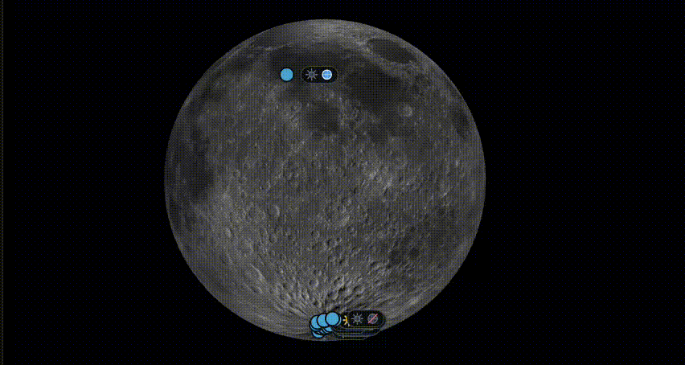

# Lunav One — Lunar Landing Site Navigator



**Explore how lunar terrain and time shape sunlight and Earth visibility.**

Lunav One is a completed educational and exploratory prototype built for the
[2026 NASA Space Apps Challenge](https://www.spaceappschallenge.org/2026/challenges/lunar-landing-site-navigator/).
It connects NASA data with an interactive view of the Moon, documented lunar
locations and a Site Planner, helping people explore modeled conditions and
understand what the results mean.

[**Open the application**](https://lunavone.streamlit.app/)

## Official Demo

[**Watch the official demo on YouTube**](https://youtu.be/ASh9yAMIm1U)

See Lunav One in action: explore the Moon, select a location and follow changing
Sun and Earth indicators with the interactive timeline.

## Features

| Feature | What you can explore |
|---|---|
| **Interactive Moon View** | A 3D lunar globe and south polar map with imagery, illustrative relief layers and navigation controls |
| **Lunar Site Catalog** | 17 documented Catalog Sites, with scientific context, images and references in their Site Cards |
| **Sunlight and Earth Visibility** | Modeled lighting and geometric Earth visibility, with charts and visual indicators |
| **Interactive Timeline** | How conditions change over time through UTC selection and playback |
| **Site Planner** | Locations, Asset Height and terrain-aware conditions, including a selectable Site Neighborhood |
| **Custom Sites** | Coordinates beyond the catalog, with named locations retained during the session |

The interface supports desktop and mobile exploration. The
[technical guide](docs/technical_guide.md) explains the controls, coordinate
sources, data coverage and standalone offline map.

## Technologies

Python, Streamlit, Pandas, NumPy, Rasterio, Requests, Plotly, JavaScript,
Three.js, globe.gl, Leaflet, Proj4js and Proj4Leaflet. Tests use Pytest and
Streamlit AppTest.

## Scientific checks

**Consistency-checked against published studies; independent validation not performed.**

- **Solar illumination:** averages for four study points differ by less than
  **1.2 percentage points** from Gläser et al. (2017).
- **Earth Visibility:** seven polar locations were compared with NASA PGDA's
  reference map, with differences up to **4.6 percentage points**; six were
  within **1.3 percentage points**.

See the [scientific comparison](docs/pitch/illumination_comparison.md) for the
reference values, methods and reproducible checks. Lunav One does not certify
safe landing locations, guarantee operational communication or calculate actual
electrical power generation. The [scientific explainer](docs/pitch/mission_explainer.md)
provides further context and limitations.

## Install and run

Requires **Python 3.11+**.

```bash
python -m venv .venv
```

Activate with `source .venv/bin/activate` on Linux/macOS, or
`.venv\Scripts\Activate.ps1` in Windows PowerShell. Then run:

```bash
python -m pip install -r requirements.txt
python -m streamlit run app.py
```

To run the tests:

```bash
python -m pip install pytest
python -m pytest -q
```

## Data and credits

- [JPL Horizons](https://ssd.jpl.nasa.gov/horizons/manual.html).
- [NASA LOLA / PGDA terrain](https://pgda.gsfc.nasa.gov/products/78) and
  [polar visibility references](https://pgda.gsfc.nasa.gov/products/69).
- [NASA Moon Trek](https://trek.nasa.gov/moon/) and [LROC](https://lroc.im-ldi.com/).
- [NASA Lunar Surface Data Book](https://ntrs.nasa.gov/api/citations/20230007818/downloads/ACD-50044%20Lunar%20Surface%20Data%20Book%20Rev%20A.pdf).
- [Gläser et al. (2017)](https://ntrs.nasa.gov/citations/20170007365).

NASA provides source data and imagery; Lunav One computes the displayed
conditions. Additional references include [LROC QuickMap](https://quickmap.lroc.im-ldi.com/)
and [CSA lunar exploration resources](https://www.asc-csa.gc.ca/eng/astronomy/moon-exploration/).
Credits and applicable terms are recorded in [THIRD_PARTY_NOTICES.md](THIRD_PARTY_NOTICES.md).
No agency endorsement is implied.

## Team

**Lunav One** — João Gabriel Santos (Data & Science), Igor Wanderley
(Interface & Deployment) and Renata Andrade (Sites, Context & Pitch).

## License

Original code and documentation: **Apache License 2.0 — Apache-2.0**.
See [LICENSE](LICENSE) and [NOTICE](NOTICE). Copyright 2026 Lunav One contributors.
External imagery, data and software retain their own terms, detailed in
[THIRD_PARTY_NOTICES.md](THIRD_PARTY_NOTICES.md).

[Project documentation](docs/technical_guide.md) ·
[Submission text](docs/pitch/submission_draft.md) ·
[Official demo script](docs/pitch/demo_30s.md) ·
[Shared vocabulary](GLOSSARY.md) ·
[Architecture decisions](docs/adr/) ·
[Release review](docs/final_release_review.md)
